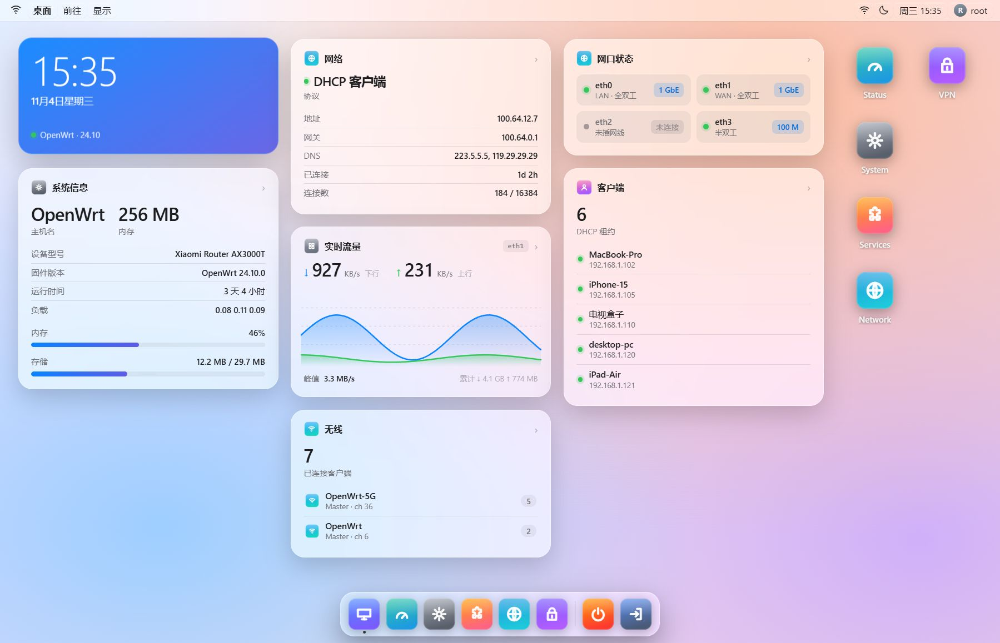
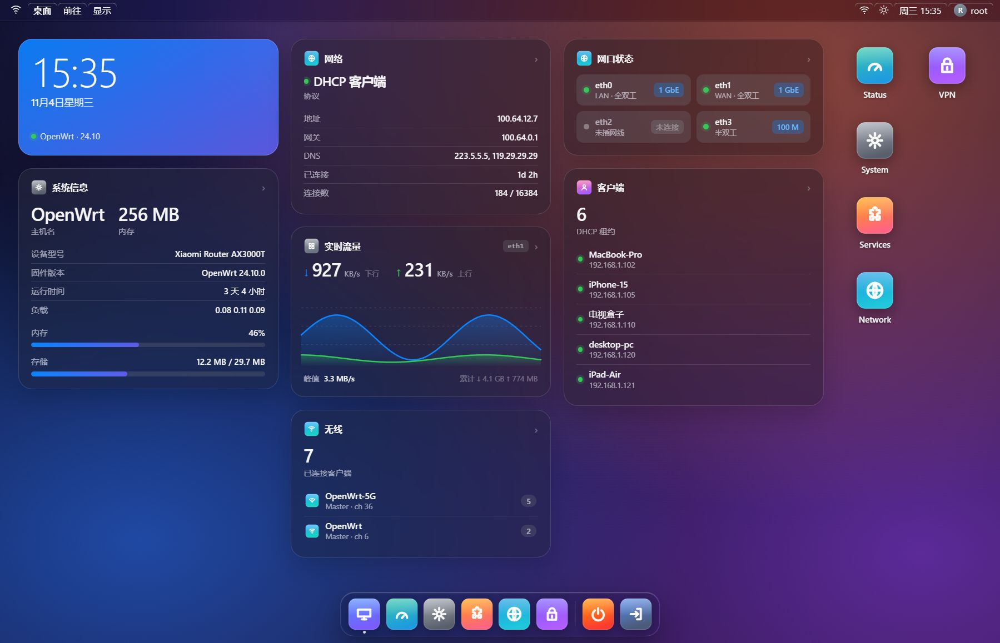
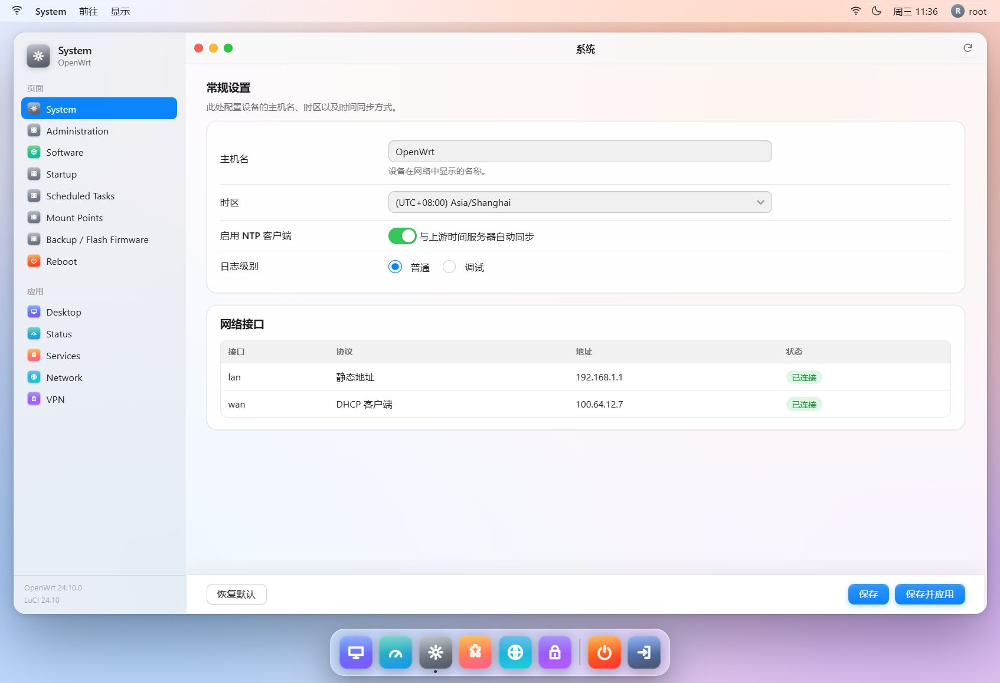
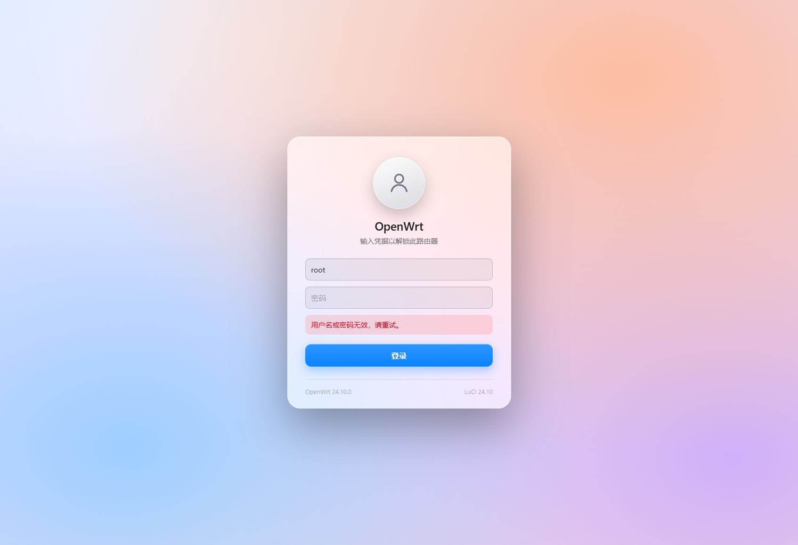
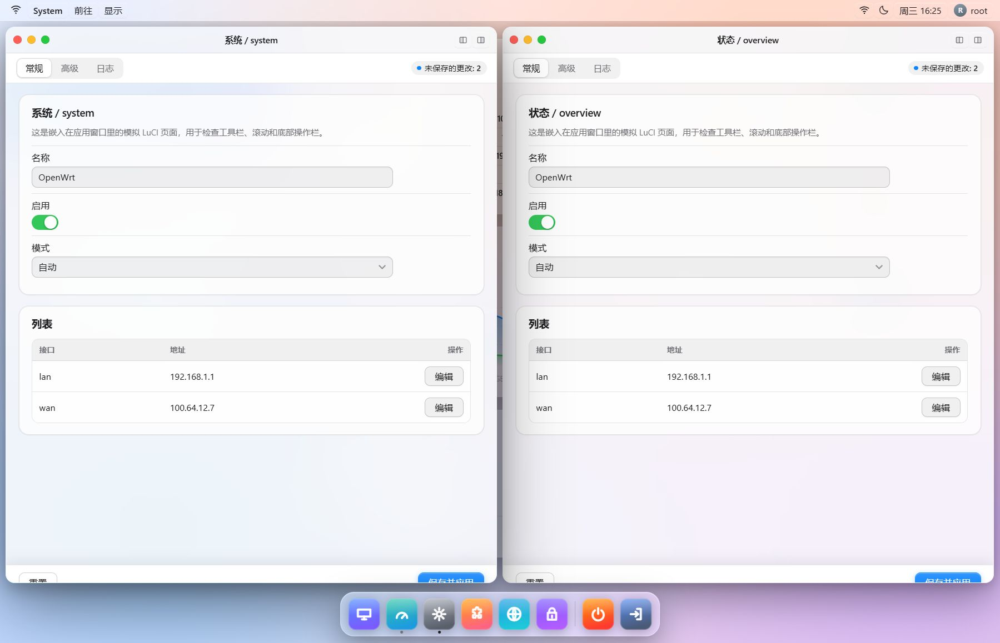

# luci-theme-macos

一款为 OpenWrt / LuCI 设计的 **macOS 风格主题**。它彻底放弃了传统路由器后台“顶部导航 + 表单堆叠”的布局，改用：

- **桌面（Desktop）作为首页**：实时显示系统、网络、无线、客户端等信息小组件；
- **实时流量曲线**：基于 `luci-bwc` 的上下行速率折线图，以及网口状态、协商速率与双工模式；
- **真多窗口 + 分屏**：应用在独立窗口中打开，可拖拽、缩放、最小化、最大化、左右半屏，拖到屏幕边缘自动吸附；
- **Dock 栏**：像 macOS 一样从底部启动各个 LuCI 应用；
- **应用窗口**：每个设置页面都是带红黄绿信号灯的“窗口”，左侧为 Finder 风格边栏；
- **顶部菜单栏**：当前应用菜单、前往、显示、状态指示、时钟、用户菜单；
- **macOS 风格登录页**：模糊壁纸 + 头像 + 密码框。

> 适用于使用 **ucode 模板** 的 LuCI（OpenWrt 24.10 及以后，含 25.x 系列）。不适用于 23.05 及更早的 Lua 模板主题机制。

## 截图

| 桌面（浅色） | 桌面（深色） |
| --- | --- |
|  |  |

| 应用窗口 | 登录页 |
| --- | --- |
|  |  |

| 多窗口 / 左右分屏 |
| --- |
|  |

## 预览

仓库自带两套静态预览页（不依赖路由器）：

```sh
node tools/preview-server.js
```

- **沙盒运行（推荐）**：用极简的 LuCI 运行时垫片加载主题真实 JS，并模拟内核数据
  - <http://127.0.0.1:8123/preview/mock-desktop.html>（点击 Dock / 桌面图标可打开多窗口，拖动标题栏或窗口边缘可分屏）
  - <http://127.0.0.1:8123/preview/mock-window.html>
  - <http://127.0.0.1:8123/preview/mock-frame.html>（模拟窗口内嵌页面）
- **纯 HTML/CSS 预览**：不执行主题 JS，只用于检查样式
  - <http://127.0.0.1:8123/preview/desktop.html>
  - <http://127.0.0.1:8123/preview/window.html>
  - <http://127.0.0.1:8123/preview/login.html>
  - <http://127.0.0.1:8123/preview/responsive.html>（多尺寸响应式检查）
  - <http://127.0.0.1:8123/preview/components.html>（接口卡片、区域转发、嵌套表单等 LuCI 组件回归页）

预览页可以切换浅色 / 深色模式。`preview/mock/luci-mock.js` 是仅用于开发的
LuCI API 垫片，不会安装到设备上。

## 设计说明

### 1. 桌面即主页

主题通过 `root/usr/share/luci/menu.d/luci-theme-macos.json` 注册了一个 `admin/desktop` 菜单项，并设置 `order: 1`，使它成为 `admin` 的第一个子节点。LuCI 的 `firstchild` 机制会把它作为登录后的默认落地页。

桌面由 `htdocs/luci-static/resources/view/macos/desktop.js` 渲染，包含：

| 小组件 | 内容 |
| --- | --- |
| 时钟 | 路由器时间、日期、主机名、固件分支 |
| 系统信息 | 主机名、型号、固件、运行时间、负载、内存与存储占用 |
| 网络 | WAN 协议、地址、网关、DNS、在线时长、连接数 |
| 实时流量 | WAN 设备上下行实时速率曲线（约 90 个采样点）、峰值与累计流量 |
| 无线 | 各 SSID、频段/信道、已连接客户端数 |
| 网口状态 | 每个物理网口的连接状态、协商速率（10 M / 100 M / 1 GbE / 2.5 GbE…）、双工模式与 LAN/WAN 角色 |
| 客户端 | DHCP 租约数量与最近客户端 |

流量曲线每 2 秒刷新；网口状态随主轮询每 5 秒刷新；DHCP 租约与无线客户端每 30 秒刷新。
流量数据优先使用 `luci.getRealtimeStats`（与“实时图表”页面同源），在 `luci-bwc` 不可用时自动回退为直接采样内核网卡计数器。

### 2. Dock 与桌面图标

- Dock 项目 **自动** 来自 LuCI 顶级菜单（状态、系统、网络、服务、VPN……），不需要手动维护；
- 新增插件应用后，Dock 和桌面图标会自动出现；
- 图标名称到图片的映射位于 `htdocs/luci-static/resources/macos/util.js` 的 `ICONS` 表，未匹配到的应用使用通用图标。

### 3. 真多窗口与分屏

桌面页 (`admin/desktop`) 同时是**窗口外壳**。点 Dock 或桌面图标不会再整页跳转，而是打开一个应用窗口：

- 每个窗口是一个同源 `<iframe>`，加载对应的 LuCI 页面；页面在 iframe 内自动进入 **embed 模式**（`html[data-embed="1"]`），隐藏菜单栏/Dock/侧栏/窗口框，只保留内容、页内标签和“未保存更改”指示
- 窗口操作：
  - 拖拽标题栏移动，8 个方向缩放
  - 红灯关闭、黄灯最小化、绿灯最大化/还原，双击标题栏切换最大化
  - 标题栏右侧两个按钮：左半屏 / 右半屏
  - 拖到屏幕左/右边缘或顶部会显示预览并自动吸附
  - 分屏时如果已有另一个窗口，会自动把对方放到另一半
- Dock 下的小圆点表示应用已打开，当前聚焦的应用高亮；顶部菜单栏的应用菜单也会跟随聚焦窗口切换
- 窗口位置按应用记忆（localStorage），刷新页面后在当前标签页内恢复（sessionStorage）
- 最小化时暂停该窗口内的轮询，关闭时销毁 iframe 释放内存；同时最多 8 个窗口
- 深色模式切换会同步到所有窗口；窗口里登录过期会自动跳回登录页
- 宽度 ≤ 900px 时自动回退为原来的单页模式
- 直接访问 `/cgi-bin/luci/admin/...` 仍然是原来的单页整页模式，书签和分享不受影响

### 4. 窗口（单页模式）

不经由桌面外壳直接打开页面时，每个页面仍会被包进一个 macOS 窗口：

- 红色按钮：返回桌面；
- 黄色按钮：折叠/展开侧栏（移动端为抽屉）；
- 绿色按钮：窗口全屏；
- 标题栏双击：切换全屏；
- 标题栏右侧：刷新页面；
- 页面三级菜单会渲染为 macOS 分段控件（Segmented Control）。

### 5. 表单

CBI 表单被重新设计为 macOS“系统设置”风格：

- `.cbi-section` 变成圆角卡片；
- `.cbi-value` 采用“左侧标签 + 右侧控件”的行式布局；
- Checkbox 渲染为 iOS/macOS 开关；
- 按钮、输入框、下拉框、表格、模态框、进度条、提示条等全部替换外观。

## 安装

### 方式一：编译进固件（推荐）

目录名必须是 `luci-theme-macos`，直接放进 `package/` 即可（`Makefile` 会自动找到
已安装的 luci feed 中的 `luci.mk`）：

```sh
# 假设 OpenWrt 源码目录为 ~/openwrt
cp -r luci-theme-macos ~/openwrt/package/

cd ~/openwrt
make menuconfig
#   LuCI  --->  Themes  --->  <*> luci-theme-macos
make -j$(nproc)
```

> 前提是已经执行过默认的 feeds 安装（`./scripts/feeds update -a && ./scripts/feeds install -a`），
> 以便找到 `feeds/luci/luci.mk` 与 `luci-base`。

如果你维护的是完整的 LuCI feed，也可以把它放到 `feeds/luci/themes/luci-theme-macos`，
这样 `include ../../luci.mk` 会直接生效。

### 方式二：使用 SDK 单独编译 ipk

```sh
# 在 OpenWrt SDK 中（同样需要先安装 luci feed）
mkdir -p package/luci-theme-macos
cp -r /path/to/luci-theme-macos/* package/luci-theme-macos/
make package/luci-theme-macos/compile V=s
# 生成的 ipk 位于 bin/packages/*/base/luci-theme-macos_*.ipk
```

安装到设备：

```sh
opkg install luci-theme-macos_*.ipk
# 或在 LuCI 中：系统 -> 软件包 -> 上传并安装
```

安装脚本 `30_luci-theme-macos` 会注册主题并在首次安装时把 `luci.main.mediaurlbase` 指向 `/luci-static/macos`。
如果设备上已有其它主题，也可以在 **系统 → 语言和界面 → 主题** 中手动切换；卸载后会自动删除主题注册项。

> 提示：升级固件且保留配置时（`PKG_UPGRADE=1`），脚本不会强制覆盖你当前选择的主题。

## 目录结构

```
luci-theme-macos/
├── Makefile                                   # OpenWrt / LuCI 包定义
├── LICENSE                                    # Apache-2.0
├── htdocs/luci-static/macos/
│   ├── cascade.css                            # 主题全部样式
│   ├── logo.svg                               # 站点图标 / favicon
│   └── icons/*.svg                            # 应用图标（自动生成）
├── htdocs/luci-static/resources/
│   ├── macos/util.js                          # 图标映射、格式化、双语助手
│   ├── macos/windows.js                       # 多窗口 / 分屏窗口管理器
│   ├── menu-macos.js                          # 菜单栏 / 侧栏 / Dock / 标签页
│   └── view/macos/desktop.js                  # 桌面首页
├── ucode/template/themes/macos/
│   ├── header.ut                              # 菜单栏 + 窗口框架
│   ├── footer.ut                              # Dock + 收尾标签
│   └── sysauth.ut                             # 登录页
├── root/etc/uci-defaults/30_luci-theme-macos  # 主题注册
├── root/usr/share/luci/menu.d/
│   └── luci-theme-macos.json                  # admin/desktop 菜单项
├── tools/
│   ├── gen-icons.js                           # 图标生成脚本
│   └── preview-server.js                      # 本地预览服务器
├── preview/                                   # 静态 / 模拟预览页（不打包进 ipk）
│   └── mock/luci-mock.js                      # 开发用 LuCI API 垫片
└── docs/                                      # 截图
```

## 自定义

### 更换应用图标

1. 修改 `tools/gen-icons.js` 中的 `ICONS`（渐变色、字形）或直接替换
   `htdocs/luci-static/macos/icons/<name>.svg`；
2. 如果是新增图标，在 `htdocs/luci-static/resources/macos/util.js` 的 `ICONS`
   映射表中把菜单名指向它；
3. 重新生成图标：

```sh
node tools/gen-icons.js
```

### 更换壁纸

壁纸完全由 CSS 渐变构成（无外部图片），位于 `cascade.css` 的 `.wallpaper` 与
`html[data-darkmode="true"] .wallpaper` 规则中。替换为图片也很简单：

```css
.wallpaper {
    background: url("/luci-static/macos/wallpaper.jpg") center/cover no-repeat;
}
```

### 深色模式

- 默认跟随系统 `prefers-color-scheme`；
- 顶部菜单栏的太阳/月亮按钮可手动切换，选择保存在 `localStorage.macos-darkmode`；
- 颜色变量集中在 `cascade.css` 顶部的 `:root` 与 `html[data-darkmode="true"]`。

### 界面文案

主题自身的少量界面文字（桌面小组件标题、Dock 提示等）通过
`macos/util.js` 的 `t(en, zh)` 提供中英双语，菜单、表单等文字仍由 LuCI
自身的翻译系统处理。

## 已知限制

- 桌面首页依赖 `admin/desktop` 菜单项与 `view/macos/desktop.js`；该菜单项还额外依赖
  `luci.main.mediaurlbase = /luci-static/macos`，因此切换到其它主题后它不会出现在菜单中
  （直接访问该 URL 会自动跳转到状态概览）。若手动删除该菜单项，登录后将回落到第一个可用页面。
- 需要浏览器启用 JavaScript（LuCI 本身也如此）。
- 极少数第三方插件使用完全自定义的内联样式时，可能无法完全套用本主题的卡片/表单外观。
- 窄屏（≤ 820px）下侧栏默认收起，通过菜单栏左侧的按钮或黄色信号灯打开。
- 多窗口模式下，每个窗口都是一个完整页面（iframe），同时开得越多内存占用越高，默认上限 8 个；
  关闭窗口会释放，最小化会暂停该窗口轮询。
- 浏览器前进/**后退**暂不支持在窗口之间导航；“刷新”会从 sessionStorage 恢复当前标签页的窗口。
- 极少数假设自己运行在顶层窗口的第三方页面，可能在窗口内表现异常（可改用直接访问的整页模式）。

## 许可

Apache License 2.0，详见 [LICENSE](LICENSE)。
